# FireLamp ESP32

[](https://github.com/golyakoff/FireLamp_ESP32/actions/workflows/build.yml)
[](https://github.com/golyakoff/FireLamp_ESP32/releases/latest)
[](LICENSE)

[Русский](README.md) | **English**

Firmware for a "fire lamp": an LED matrix on ESP32 or ESP32-C3 controlled from a phone over
Bluetooth Low Energy. No cloud, no account; WiFi is optional.

The Android app: **[FireLamp Android](https://github.com/golyakoff/FireLamp_Android)**
([download the APK](https://github.com/golyakoff/FireLamp_Android/releases/latest)).

Based on [EvLamp](https://github.com/UncleRus/EvLamp) by Ruslan V. Uss (effects in pure C on
ESP-IDF), some effects come from [GyverLamp gunner47_v2](https://github.com/nikitakiselev/gunner47_v2),
the BLE control follows [Matrix_Clock_ESP32](https://github.com/golyakoff/Matrix_Clock_ESP32).

- 40 effects: fire, lava, waterfall, matrix, starfall, thunderstorm, fireflies, GIF animations and more
- Parameters of every effect and a Tempo that slows an effect down smoothly at the same frame rate
- Demo mode, power on/off schedule, dawn alarm, brightness by the hour
- Matrices from 8x8 to 32x32: any corner of the input, serpentine or progressive, current limit
- One button (or a TTP223 touch module), four buttons or the ESP32 touch pad
- Optional DS3231 RTC and AT24Cxx EEPROM, detected automatically
- Firmware update from the phone over BLE or by the lamp itself from the internet, with rollback

## Contents

- [Effects](#effects)
- [Quick start](#quick-start)
- [Parts](#parts)
- [Wiring](#wiring)
- [Matrix setup](#matrix-setup)
- [Flashing](#flashing)
- [Button controls](#button-controls)
- [App and protocol](#app-and-protocol)
- [Features](#features)
- [Building from source](#building-from-source)
- [License](#license)

## Effects

Previews on a 16x16 matrix with the default parameters, slowed down. The full list with the codes
is in [preview/README.md](preview/README.md).

<table>
<tr>
<td align="center">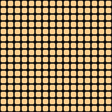<br><sub>Color lamp</sub></td>
<td align="center">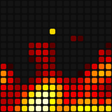<br><sub>Fire</sub></td>
<td align="center">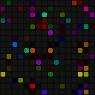<br><sub>Sparkles</sub></td>
<td align="center">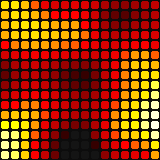<br><sub>Lava</sub></td>
<td align="center">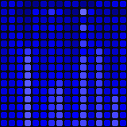<br><sub>Waterfall</sub></td>
</tr>
<tr>
<td align="center">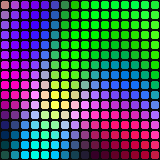<br><sub>Plasma waves</sub></td>
<td align="center">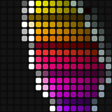<br><sub>DNA helix</sub></td>
<td align="center"><br><sub>Matrix</sub></td>
<td align="center">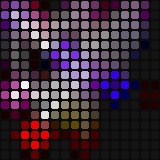<br><sub>Crazy bees</sub></td>
<td align="center">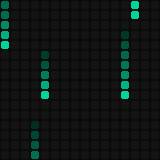<br><sub>Rain</sub></td>
</tr>
<tr>
<td align="center">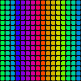<br><sub>Rainbow</sub></td>
<td align="center">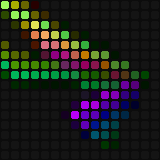<br><sub>Rays</sub></td>
<td align="center">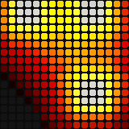<br><sub>Metaballs</sub></td>
<td align="center">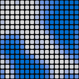<br><sub>Water</sub></td>
<td align="center">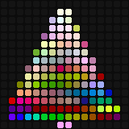<br><sub>Holiday lights</sub></td>
</tr>
<tr>
<td align="center">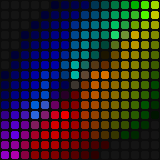<br><sub>Hoop</sub></td>
<td align="center">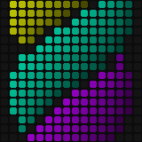<br><sub>Twister</sub></td>
<td align="center">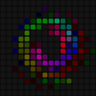<br><sub>Flower</sub></td>
<td align="center">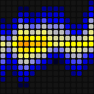<br><sub>Polar lights</sub></td>
<td align="center"><br><sub>Gif image</sub></td>
</tr>
<tr>
<td align="center">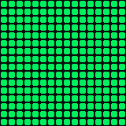<br><sub>Relax</sub></td>
<td align="center">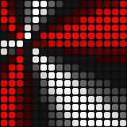<br><sub>Radiant wheel</sub></td>
<td align="center">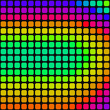<br><sub>Peacock tail</sub></td>
<td align="center">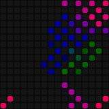<br><sub>Diagonal movements</sub></td>
<td align="center">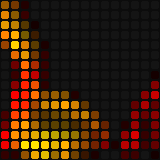<br><sub>Whirls</sub></td>
</tr>
<tr>
<td align="center"><br><sub>Sun radiation</sub></td>
<td align="center">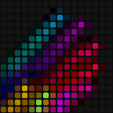<br><sub>Flight of spaceships</sub></td>
<td align="center">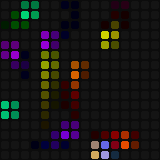<br><sub>Fireflies</sub></td>
<td align="center">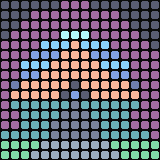<br><sub>Tunnel</sub></td>
<td align="center">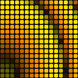<br><sub>Colored dunes</sub></td>
</tr>
<tr>
<td align="center">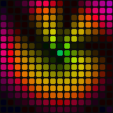<br><sub>Octopus</sub></td>
<td align="center">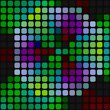<br><sub>Nuclear Noise</sub></td>
<td align="center">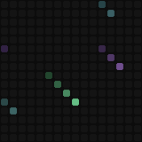<br><sub>Starfall</sub></td>
<td align="center">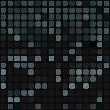<br><sub>Thunderstorm</sub></td>
<td align="center">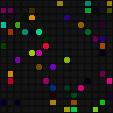<br><sub>Twinkles</sub></td>
</tr>
<tr>
<td align="center">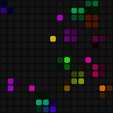<br><sub>Butterflies</sub></td>
<td align="center">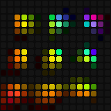<br><sub>Rainbow snake</sub></td>
<td align="center">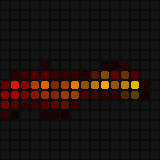<br><sub>Soaring fire</sub></td>
<td align="center">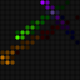<br><sub>Fireflies with trails</sub></td>
<td align="center">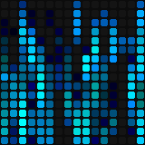<br><sub>Drops on glass</sub></td>
</tr>
</table>

## Quick start

1. **Build** the lamp following the [wiring](#wiring): a board, a matrix, a 5 V supply, a button.
2. **Flash** the board from the [latest release](https://github.com/golyakoff/FireLamp_ESP32/releases/latest):
   unpack the zip of your chip and run `flash_esp32.bat` (or `flash_esp32c3.bat`), see
   [Flashing](#flashing).
3. **Install** the [app](https://github.com/golyakoff/FireLamp_Android/releases/latest) on the phone.
4. **Connect** within 2 minutes after powering the lamp on: the app finds `FireLamp-XXXX` and offers
   to pair. Later, 5 clicks of the button open the pairing window again.
5. **Set up the matrix** in the app: System → LED matrix (size, rotation, wiring, current limit) and
   reboot the lamp.

## Parts

| | What | Notes |
|---|---|---|
| Board | ESP32 (ESP32-WROOM-32D etc.) or ESP32-C3 (SuperMini, ESP32-C3-FH4) | 4 MB flash |
| Matrix | WS2812B, SK6812 or WS2811, 8x8 to 32x32 (up to 1024 LEDs) | 16x16 recommended |
| Power | 5 V supply | 8x8: 2 A or more, 16x16: 4 A or more; the current limit is a setting |
| Small parts | 330 Ω resistor, 1000 µF 6.3–10 V capacitor | on the data line and the matrix power |
| Control | a momentary button or a TTP223 module | or 4 buttons, or the ESP32 touch pad |
| Optional | DS3231 module and/or AT24C32…AT24C512 EEPROM (address 0x50) | time without power, settings outside the flash |

## Wiring

### ESP32

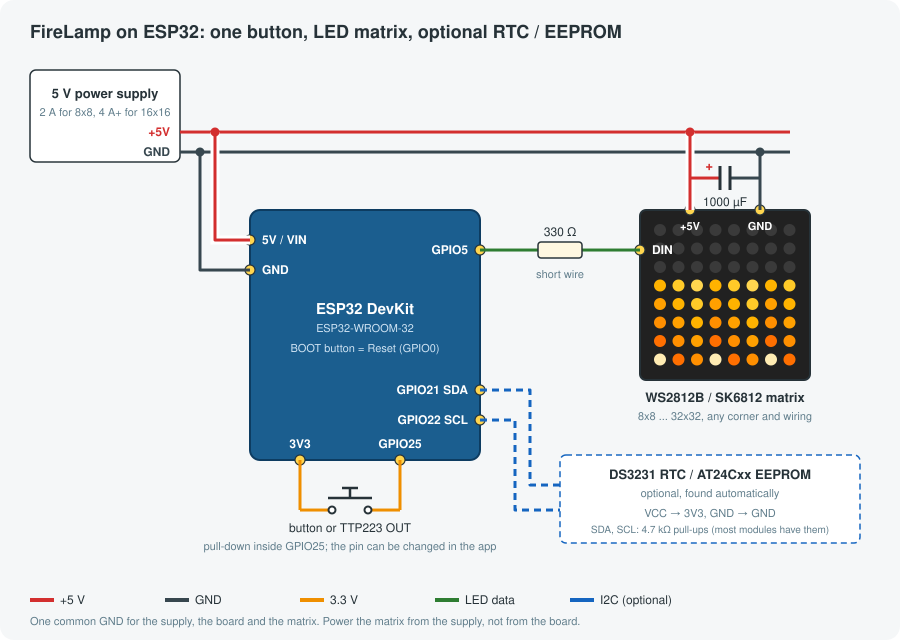

### ESP32-C3


### Pins

One firmware per chip fits every lamp with this pinout:

| Function | ESP32 | ESP32-C3 |
|---|---|---|
| Matrix data (through 330 Ω) | GPIO5 | GPIO5 |
| Main button (can be moved in the app) | GPIO25 | GPIO4 |
| Up / Down buttons (four buttons mode) | GPIO26 / GPIO27 | GPIO6 / GPIO7 |
| Reset button (to GND) | GPIO0 (BOOT) | GPIO9 (BOOT) |
| Touch pad | T0 = GPIO4 | — |
| I2C SDA / SCL (DS3231, EEPROM) | GPIO21 / GPIO22 | GPIO3 / GPIO10 |

The main button can be moved in the app (System → Controls → Button pin) to any free input with
an internal pull resistor: ESP32 — GPIO 4, 13, 14, 18, 19, 23, 25, 32, 33; ESP32-C3 — GPIO 1, 4.

### Assembly tips

- **One common GND** for the supply, the board and the matrix, otherwise the matrix flickers or
  shows garbage.
- **Power the matrix from the supply directly**, not through the board: the board has a diode and
  thin traces on USB. Feed 16x16 and bigger matrices from both ends.
- **The 330 Ω resistor** goes on the data line close to DIN, **the 1000 µF capacitor** across the
  matrix power. Without them random colors and hangs happen.
- **3.3 V on DIN** is usually enough for WS2812B with a short wire (up to 20–30 cm). If it glitches,
  add a level shifter (74AHCT125 powered from 5 V).
- **The button** goes between the pin and 3.3 V by default (the pull-down is inside), a TTP223
  module the same way with its output. A button to GND works too: choose "To GND" in the app
  (System → Controls).
- **Four buttons** and **the ESP32 touch pad** are selected in the app in the same place.
- **DS3231 and EEPROM** go on I2C and are found at boot. With an EEPROM the settings live in it and
  survive a full flash erase; an EEPROM added later takes the settings over from the flash.

## Matrix setup

Find which LED the DIN input is connected to and where the strip goes from there, and set Rotation
and Mirror in the app:

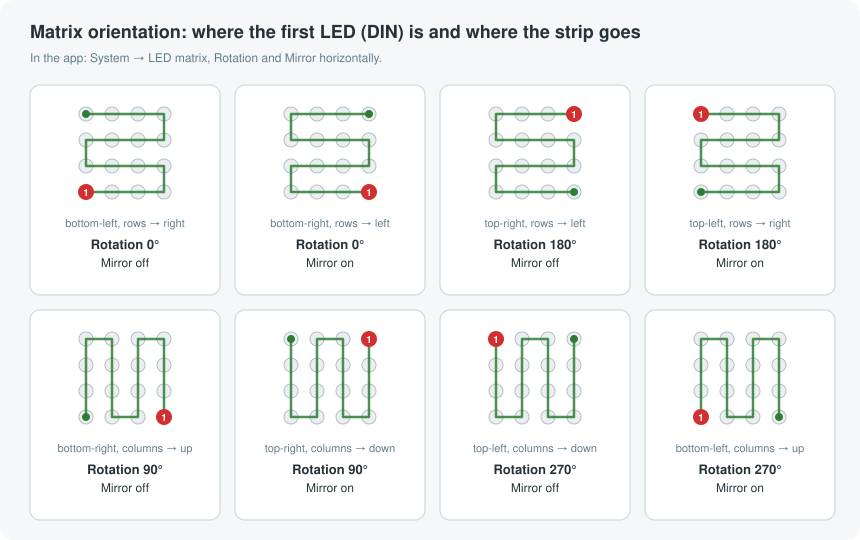

The size, LED type, color order (GRB/RGB), wiring (serpentine or progressive) and the current
limit of all LEDs (not more than the supply gives) are set there too. The matrix settings apply
after a reboot. An easy check is the Fire effect: the flames must rise from the bottom.

## Flashing

Every [release](https://github.com/golyakoff/FireLamp_ESP32/releases/latest) has, for each chip, a zip
with the separate images and a `flash_<chip>.bat` script, and a single image `*_full.bin`.

**Windows.** Install [Python 3](https://www.python.org/downloads/) (tick "Add python.exe to PATH"),
connect the board over USB, unpack the zip and run `flash_esp32.bat` (or `flash_esp32c3.bat COM5`
to give the port). The script installs esptool itself. Stuck at `Connecting...` — hold the BOOT
button while plugging in USB. No COM port — install the CP210x or CH340 driver (an ESP32-C3 with
native USB needs none).

**Linux / macOS:**

```bash
python3 -m pip install --upgrade esptool
python3 -m esptool --chip esp32 write-flash --flash-mode dio --flash-size 4MB --flash-freq 80m \
  0x1000 firelamp_vX.Y.Z_esp32_bootloader.bin 0x8000 firelamp_vX.Y.Z_esp32_pt.bin \
  0xe000 firelamp_vX.Y.Z_esp32_otadata.bin 0x20000 firelamp_vX.Y.Z_esp32_fw.bin
```

On ESP32-C3 the bootloader goes to `0x0`, not `0x1000`; the exact commands for both chips are on the
release page.

**From the browser.** The single image `*_full.bin` is written at `0x0` with the
[ESP Web Flasher](https://espressif.github.io/esptool-js/). It erases the lamp's settings too, so it
is for a first install, not for an update.

The `.bat` keeps the settings: the `nvs` partition (`0x9000`) with the settings and paired phones is
not written. A lamp already running FireLamp is easier to update from the app.

> **`MD5 of file does not match data in flash`.** Some cheap modules have the flash write protected
> by a status register bit: the erase "succeeds" at once and the write does not match. To remove the
> protection:
> `python -m esptool --chip esp32 --port COM3 write_flash_status --non-volatile --bytes 2 0x0200`

## Button controls

One button, a TTP223 module or the ESP32 touch pad:

| Lamp | Gesture | Action |
|---|---|---|
| off | click | turn on |
| off | hold 10 s | reset all settings and reboot |
| on | click | turn off |
| on | double click | next effect |
| on | triple click | previous effect |
| on | hold | brightness; the direction alternates with every hold |
| any | 5 clicks | open the pairing window for 2 minutes (short blue blink) |

Four buttons (as in EvLamp): **Main** — click: next effect, 5 clicks: pairing window, hold 1.5 s:
on/off; **Up/Down** — brightness, hold to repeat; **Reset** — hold 3 s: reset all settings.

In the demo mode next/previous effect switch to the neighbouring included effect and the demo goes on.

## App and protocol

The lamp is controlled by the [FireLamp Android](https://github.com/golyakoff/FireLamp_Android) app:
effects and their parameters, demo mode, schedule, matrix, buttons, WiFi, lamp name, firmware update.
Its README has the description and screenshots.

<p align="center">
  <a href="https://github.com/golyakoff/FireLamp_Android"></a>
  <a href="https://github.com/golyakoff/FireLamp_Android"></a>
  <a href="https://github.com/golyakoff/FireLamp_Android"></a>
</p>

For your own clients:

- [docs/BLE_PROTOCOL.md](docs/BLE_PROTOCOL.md) — the BLE protocol: characteristics and bytes;
- [docs/APP_INTEGRATION.md](docs/APP_INTEGRATION.md) — how an app works with the lamp: discovery,
  pairing, caching, updates;
- [API.md](API.md) — the JSON HTTP API in the "always on" WiFi mode.

Effects and parameters are identified by text codes (`fire`, `plasma_waves`, `speed`), so app and
firmware versions do not depend on the order of effects. The lamp accepts paired phones only; a new
one within 2 minutes after power on or after 5 clicks, up to 4 phones are remembered.

## Features

**Effects and Tempo.** The effects without their own speed have a Tempo parameter (10–100 %): the
lamp keeps its frame rate and blends the frames between the effect steps, so a slowed effect does
not stutter. The effects run on their own clock, so all their parts slow down together.

**Demo mode.** The included effects one after another or in random order, each for a set time plus a
random addition. Effects can be excluded. The mode survives a reboot.

**Time and schedule.** The lamp keeps UTC and a POSIX time zone (daylight saving time is handled).
The time comes from the DS3231 at boot, from the phone, from the internet (SNTP) or the HTTP API; the
DS3231, when present, is corrected by them. The schedule:

- power on and off by time and days of the week;
- dawn: the lamp turns on with a chosen effect and raises the brightness over 1–120 minutes to the
  set time; any manual control stops it;
- brightness by the hour: 24 values, applied when the lamp turns on and at the start of every hour.

**WiFi (optional).** The lamp works without WiFi. With a network set up (from the app) it connects as
a client: **periodically** (every 1–24 hours: syncs the time, checks for updates and disconnects) or
**always** (the [HTTP API](API.md) is available). There is no access point: the network is set up
over BLE.

**Firmware update.** From the phone over BLE (the app uploads the release `.bin`) or by the lamp from
the internet: on every WiFi session the lamp reads `manifest.json` of the latest release and reports a
new version, and installs it **only on request** from the app. The image (and its SHA-256 when known)
is verified; if the new firmware does not start, the bootloader rolls back.

**Settings storage.** In the EEPROM when there is one, otherwise in the internal flash (NVS). Every
record has a magic, size and CRC; in the EEPROM a record has two copies written alternately, so a
power loss during a write keeps the previous one. Frequently changed values (brightness, effect,
parameters) are written 15 seconds after the last change and on reboot. Effect parameters are stored
by effect code and survive updates that add or reorder effects.

## Building from source

Requires ESP-IDF v5.5.x (the project does not build with v6).

```bash
. ~/esp/esp-idf-v5.5.6/export.sh

# ESP32
idf.py -B build-esp32 -DSDKCONFIG=build-esp32/sdkconfig -DIDF_TARGET=esp32 build
# ESP32-C3
idf.py -B build-esp32c3 -DSDKCONFIG=build-esp32c3/sdkconfig -DIDF_TARGET=esp32c3 build

# configure / flash / monitor (same -B/-DSDKCONFIG arguments)
idf.py -B build-esp32c3 -DSDKCONFIG=build-esp32c3/sdkconfig menuconfig
idf.py -B build-esp32c3 -DSDKCONFIG=build-esp32c3/sdkconfig -p /dev/ttyACM0 flash monitor
```

Each chip keeps its own build directory and sdkconfig, so both can be built side by side. Project
options are in `menuconfig` → `*** FireLamp configuration ***`. LED output uses
[espressif/led_strip](https://components.espressif.com/components/espressif/led_strip): SPI with DMA
on ESP32-C3, RMT on ESP32; the previous frame is sent while the next one is computed.

**Host tests** — settings storage with a simulated EEPROM and power loss, button gestures,
schedule, demo mode, unique hashes of the effect codes:

```bash
make -C test/host
```

**Hardware tests** — the PC plays the phone over BLE and reads the lamp's log over USB, see
[test/hil/README.md](test/hil/README.md).

**Effects benchmark.** `Benchmark all effects at boot` in menuconfig: at boot every effect runs 100
frames and the average and maximum frame time is logged.

**Previews and diagrams.** The effect GIFs — `tools/preview/make_previews.py`, the diagrams of this
README — `tools/docs/diagrams.py`.

### Releases

Every push builds the firmware for both chips and runs the tests
([build.yml](.github/workflows/build.yml)). To release, bump `version.txt`, add a section to
[CHANGELOG.md](CHANGELOG.md), commit and push a tag `v<version>` (it must match `version.txt`). The
workflow builds both chips and publishes the images, the single image, the `.bat`, the zip and
`manifest.json` for the internet update ([tools/make_release.sh](tools/make_release.sh)).

### Build variant

Releases contain one build per chip with the reference pinout (variant `default`). A lamp with other
pins needs its own build: set the pins and a variant name of your own in menuconfig
(`*** FireLamp configuration ***` → `Build variant name`). The internet update installs only a build
of the same chip and variant, so an official release never gets onto such a lamp.

### Flash layout (4 MB)

| Partition | Offset | Size |
|---|---|---|
| nvs | `0x9000` | 20 KB |
| otadata | `0xe000` | 8 KB |
| phy_init | `0x10000` | 4 KB |
| ota_0 | `0x20000` | 1920 KB |
| ota_1 | `0x200000` | 1920 KB |

The bootloader is at `0x1000` on ESP32 and at `0x0` on ESP32-C3.

## License

MIT, see [LICENSE](LICENSE). The bundled [libnsgif](components/libnsgif/libnsgif) is MIT licensed
(see its `COPYING`).
