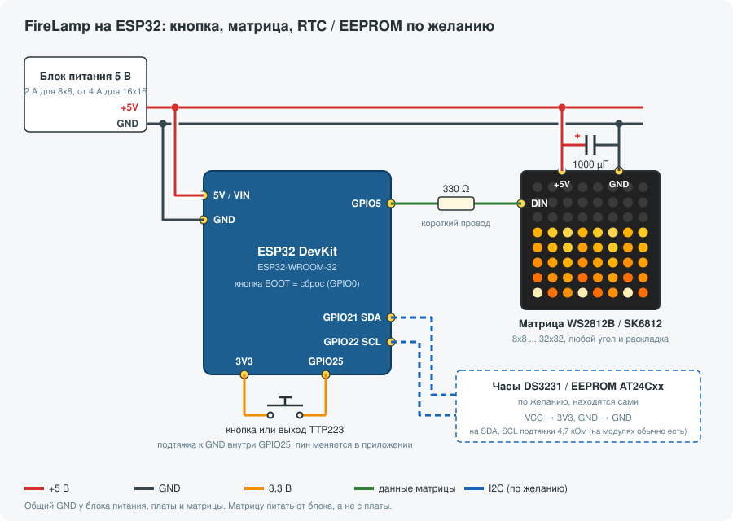
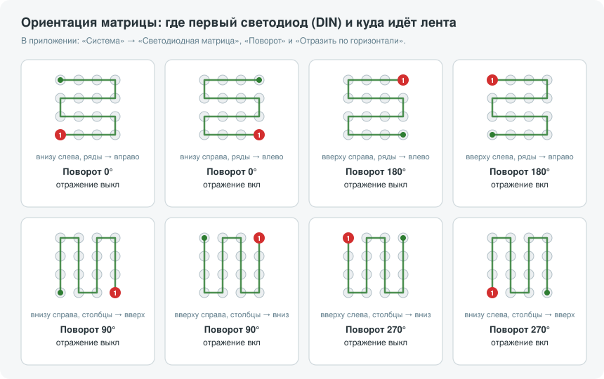

# FireLamp ESP32

[](https://github.com/golyakoff/FireLamp_ESP32/actions/workflows/build.yml)
[](https://github.com/golyakoff/FireLamp_ESP32/releases/latest)
[](LICENSE)

**Русский** | [English](README.en.md)

Прошивка «огненной лампы» — светодиодной матрицы на ESP32 или ESP32-C3, которой управляют с
телефона по Bluetooth Low Energy. Без облака и аккаунтов; WiFi не обязателен.

Управляющее приложение для Android: **[FireLamp Android](https://github.com/golyakoff/FireLamp_Android)**
([скачать APK](https://github.com/golyakoff/FireLamp_Android/releases/latest)).

Основа — [EvLamp](https://github.com/UncleRus/EvLamp) Руслана Усса (эффекты на чистом C под
ESP-IDF), часть эффектов — из [GyverLamp gunner47_v2](https://github.com/nikitakiselev/gunner47_v2),
управление по BLE сделано по образцу [Matrix_Clock_ESP32](https://github.com/golyakoff/Matrix_Clock_ESP32).

- 40 эффектов: огонь, лава, водопад, матрица, звездопад, гроза, светлячки, GIF-анимации и другие
- Параметры каждого эффекта и «Темп» с плавным замедлением без потери частоты кадров
- Демо-режим, расписание включения и выключения, «рассвет», яркость по часам
- Матрица от 8x8 до 32x32: любой угол подключения, змейка или построчно, ограничение тока
- Одна кнопка (или сенсор TTP223), четыре кнопки или сенсорная площадка ESP32
- Часы DS3231 и EEPROM AT24Cxx по желанию — находятся сами
- Обновление прошивки с телефона по BLE или самой лампой из интернета, с автоматическим откатом

## Содержание

- [Эффекты](#эффекты)
- [Быстрый старт](#быстрый-старт)
- [Что нужно](#что-нужно)
- [Подключение](#подключение)
- [Настройка матрицы](#настройка-матрицы)
- [Прошивка](#прошивка)
- [Управление кнопкой](#управление-кнопкой)
- [Приложение и протокол](#приложение-и-протокол)
- [Возможности](#возможности)
- [Сборка из исходников](#сборка-из-исходников)
- [Лицензия](#лицензия)

## Эффекты

Превью на матрице 16x16 с параметрами по умолчанию, кадры замедлены. Полный список с кодами — в
[preview/README.md](preview/README.md).

<table>
<tr>
<td align="center"><br><sub>Цветная лампа</sub></td>
<td align="center"><br><sub>Огонь</sub></td>
<td align="center"><br><sub>Искры</sub></td>
<td align="center"><br><sub>Лава</sub></td>
<td align="center"><br><sub>Водопад</sub></td>
</tr>
<tr>
<td align="center"><br><sub>Плазменные волны</sub></td>
<td align="center"><br><sub>Спираль ДНК</sub></td>
<td align="center"><br><sub>Матрица</sub></td>
<td align="center"><br><sub>Безумные пчёлы</sub></td>
<td align="center"><br><sub>Дождь</sub></td>
</tr>
<tr>
<td align="center"><br><sub>Радуга</sub></td>
<td align="center"><br><sub>Лучи</sub></td>
<td align="center"><br><sub>Метаболы</sub></td>
<td align="center"><br><sub>Вода</sub></td>
<td align="center"><br><sub>Гирлянда</sub></td>
</tr>
<tr>
<td align="center"><br><sub>Обруч</sub></td>
<td align="center"><br><sub>Твистер</sub></td>
<td align="center"><br><sub>Цветок</sub></td>
<td align="center"><br><sub>Северное сияние</sub></td>
<td align="center"><br><sub>GIF-картинка</sub></td>
</tr>
<tr>
<td align="center"><br><sub>Релакс</sub></td>
<td align="center"><br><sub>Сияющее колесо</sub></td>
<td align="center"><br><sub>Павлиний хвост</sub></td>
<td align="center"><br><sub>Диагонали</sub></td>
<td align="center"><br><sub>Вихри</sub></td>
</tr>
<tr>
<td align="center"><br><sub>Солнечное излучение</sub></td>
<td align="center"><br><sub>Полёт кораблей</sub></td>
<td align="center"><br><sub>Светлячки</sub></td>
<td align="center"><br><sub>Туннель</sub></td>
<td align="center"><br><sub>Цветные дюны</sub></td>
</tr>
<tr>
<td align="center"><br><sub>Осьминог</sub></td>
<td align="center"><br><sub>Ядерный шум</sub></td>
<td align="center"><br><sub>Звездопад</sub></td>
<td align="center"><br><sub>Гроза в банке</sub></td>
<td align="center"><br><sub>Мерцание</sub></td>
</tr>
<tr>
<td align="center"><br><sub>Мотыльки</sub></td>
<td align="center"><br><sub>Радужный змей</sub></td>
<td align="center"><br><sub>Парящий огонь</sub></td>
<td align="center"><br><sub>Светлячки со шлейфом</sub></td>
<td align="center"><br><sub>Капли на стекле</sub></td>
</tr>
</table>

## Быстрый старт

1. **Соберите** лампу по [схеме](#подключение): плата, матрица, блок питания 5 В, кнопка.
2. **Прошейте** плату из [последнего релиза](https://github.com/golyakoff/FireLamp_ESP32/releases/latest):
   распакуйте zip для своего чипа и запустите `flash_esp32.bat` (или `flash_esp32c3.bat`), см.
   [Прошивка](#прошивка).
3. **Установите** [приложение](https://github.com/golyakoff/FireLamp_Android/releases/latest) на телефон.
4. **Подключитесь** в течение 2 минут после включения лампы: приложение найдёт лампу `FireLamp-XXXX`
   и предложит спарить. Позже окно спаривания открывают 5 кликов кнопкой.
5. **Настройте матрицу** в приложении: «Система» → «Светодиодная матрица» (размер, поворот,
   раскладка, ограничение тока) и перезагрузите лампу.

## Что нужно

| | Что | Замечания |
|---|---|---|
| Плата | ESP32 (ESP32-WROOM-32D и т. п.) или ESP32-C3 (SuperMini, ESP32-C3-FH4) | 4 МБ flash |
| Матрица | WS2812B, SK6812 или WS2811, от 8x8 до 32x32 (до 1024 светодиодов) | рекомендуется 16x16 |
| Питание | блок 5 В | 8x8 — от 2 А, 16x16 — от 4 А; ток ограничивается в настройках |
| Мелочи | резистор 330 Ом, конденсатор 1000 мкФ 6,3–10 В | на линии данных и на питании матрицы |
| Управление | кнопка без фиксации или модуль TTP223 | или 4 кнопки, или сенсор ESP32 |
| По желанию | модуль DS3231 и/или EEPROM AT24C32…AT24C512 (адрес 0x50) | часы без питания, настройки вне flash |

## Подключение

### ESP32



### ESP32-C3


### Пины

Одна прошивка на чип подходит для любой лампы с этой распиновкой:

| Назначение | ESP32 | ESP32-C3 |
|---|---|---|
| Данные матрицы (через 330 Ом) | GPIO5 | GPIO5 |
| Основная кнопка (меняется в приложении) | GPIO25 | GPIO4 |
| Кнопки «+» / «−» (режим 4 кнопок) | GPIO26 / GPIO27 | GPIO6 / GPIO7 |
| Кнопка сброса (на GND) | GPIO0 (BOOT) | GPIO9 (BOOT) |
| Сенсорная площадка | T0 = GPIO4 | — |
| I2C SDA / SCL (DS3231, EEPROM) | GPIO21 / GPIO22 | GPIO3 / GPIO10 |

Основную кнопку можно перенести в приложении («Система» → «Управление» → «Пин кнопки») на любой
свободный вход с внутренней подтяжкой: на ESP32 — GPIO 4, 13, 14, 18, 19, 23, 25, 32, 33,
на ESP32-C3 — GPIO 1, 4.

### Советы по сборке

- **Общий GND** у блока питания, платы и матрицы обязателен, иначе матрица мерцает или показывает мусор.
- **Матрицу питайте прямо от блока**, а не через плату: на USB у платы диод и тонкие дорожки.
  Для 16x16 и больше подводите питание к матрице с двух сторон.
- **Резистор 330 Ом** ставьте на линии данных ближе к входу DIN, **конденсатор 1000 мкФ** — на
  питание матрицы. Без них бывают «случайные» цвета и зависания.
- **3,3 В на DIN** для WS2812B обычно хватает при коротком проводе (до 20–30 см). Если есть сбои —
  поставьте преобразователь уровня (74AHCT125 с питанием 5 В).
- **Кнопка** по умолчанию подключается между пином и 3,3 В (подтяжка к GND включается внутри),
  модуль TTP223 — так же, выходом на пин. Кнопку на GND тоже можно: выберите «На GND» в
  приложении («Система» → «Управление»).
- **Режим четырёх кнопок** и **сенсор ESP32** включаются в приложении там же.
- **DS3231 и EEPROM** подключаются к I2C и находятся при загрузке сами. С EEPROM настройки
  хранятся в ней и переживают полную очистку flash; EEPROM, добавленная позже, забирает настройки
  из flash.

## Настройка матрицы

Найдите, к какому светодиоду подходит вход DIN и куда от него идёт лента, и выставьте в приложении
«Поворот» и «Отразить по горизонтали»:



Там же задаются размер, тип светодиодов, порядок цветов (GRB/RGB), раскладка (змейкой или
построчно) и ограничение тока. Ограничение тока — это ток блока питания: лампа оставляет часть
на контроллер и погашенные светодиоды и ограничивает яркость каждого эффекта по его самому
яркому кадру, поэтому тёмный эффект при том же ограничении ярче, чем сплошной белый. Настройки
матрицы применяются после перезагрузки. Удобная проверка — эффект «Огонь»: пламя должно
подниматься снизу вверх.

## Прошивка

В каждом [релизе](https://github.com/golyakoff/FireLamp_ESP32/releases/latest) для каждого чипа есть
zip с отдельными образами и скриптом `flash_<чип>.bat`, а также единый образ `*_full.bin`.

**Windows.** Поставьте [Python 3](https://www.python.org/downloads/) (с галкой «Add python.exe to
PATH»), подключите плату по USB, распакуйте zip и запустите `flash_esp32.bat` (или
`flash_esp32c3.bat COM5`, чтобы указать порт). Скрипт сам поставит esptool. Если зависает на
`Connecting...` — держите кнопку BOOT при подключении USB. Нет COM-порта — поставьте драйвер
CP210x или CH340 (ESP32-C3 с родным USB драйвер не нужен).

**Linux / macOS:**

```bash
python3 -m pip install --upgrade esptool
python3 -m esptool --chip esp32 write-flash --flash-mode dio --flash-size 4MB --flash-freq 80m \
  0x1000 firelamp_vX.Y.Z_esp32_bootloader.bin 0x8000 firelamp_vX.Y.Z_esp32_pt.bin \
  0xe000 firelamp_vX.Y.Z_esp32_otadata.bin 0x20000 firelamp_vX.Y.Z_esp32_fw.bin
```

Для ESP32-C3 загрузчик пишется по адресу `0x0`, а не `0x1000`; точные команды для обоих чипов —
на странице релиза.

**Из браузера.** Единый образ `*_full.bin` прошивается по адресу `0x0` через
[ESP Web Flasher](https://espressif.github.io/esptool-js/). Он стирает и настройки лампы, поэтому
подходит для первой установки, а не для обновления.

Скрипт `.bat` настройки не трогает: раздел `nvs` (`0x9000`) с настройками и спаренными телефонами
сохраняется. Уже работающую лампу удобнее обновлять из приложения.

> **Ошибка `MD5 of file does not match data in flash`.** На некоторых дешёвых модулях flash
> защищена от записи битом в регистре статуса — стирание «проходит» мгновенно, а запись не
> сходится. Защита снимается так:
> `python -m esptool --chip esp32 --port COM3 write_flash_status --non-volatile --bytes 2 0x0200`

## Управление кнопкой

Одна кнопка, модуль TTP223 или сенсор ESP32:

| Лампа | Жест | Действие |
|---|---|---|
| выключена | клик | включить |
| выключена | удержание 10 с | сброс всех настроек и перезагрузка |
| включена | клик | выключить |
| включена | двойной клик | следующий эффект |
| включена | тройной клик | предыдущий эффект |
| включена | удержание | яркость; направление меняется с каждым удержанием |
| любая | 5 кликов | открыть окно спаривания на 2 минуты (короткая синяя вспышка) |

Четыре кнопки (как в EvLamp): **основная** — клик: следующий эффект, 5 кликов: окно
спаривания, удержание 1,5 с: вкл/выкл; **«+» / «−»** — яркость, удержание повторяет; **сброс** —
удержание 3 с: сброс всех настроек.

В демо-режиме следующий/предыдущий эффект переключает на соседний включённый эффект, и демо
продолжается.

## Приложение и протокол

Лампой управляет приложение [FireLamp Android](https://github.com/golyakoff/FireLamp_Android):
эффекты и их параметры, демо-режим, расписание, настройки матрицы, кнопок, WiFi, имя лампы,
обновление прошивки. Описание и скриншоты — в его README.

<p align="center">
  <a href="https://github.com/golyakoff/FireLamp_Android"></a>
  <a href="https://github.com/golyakoff/FireLamp_Android"></a>
  <a href="https://github.com/golyakoff/FireLamp_Android"></a>
</p>

Для разработчиков своих клиентов:

- [docs/BLE_PROTOCOL.md](docs/BLE_PROTOCOL.md) — протокол BLE: характеристики и байты;
- [docs/APP_INTEGRATION.md](docs/APP_INTEGRATION.md) — порядок работы приложения: поиск,
  спаривание, кеширование, обновление;
- [API.md](API.md) — HTTP API (JSON) в режиме «WiFi всегда включён».

Эффекты и параметры обозначаются текстовыми кодами (`fire`, `plasma_waves`, `speed`), поэтому
версии приложения и прошивки не зависят от порядка эффектов. Лампа принимает только спаренные
телефоны; новый — в течение 2 минут после включения или после 5 кликов, всего помнит 4 телефона.

## Возможности

**Эффекты и «Темп».** У эффектов без собственной скорости есть параметр «Темп» (10–100 %): лампа
сохраняет частоту кадров и плавно смешивает кадры между шагами эффекта, поэтому замедленный эффект
не дёргается. Эффекты идут по своим часам, так что все их части замедляются вместе.

**Демо-режим.** Включённые эффекты по очереди или в случайном порядке, каждый — заданное время
плюс случайная добавка. Эффекты можно исключать. Режим переживает перезагрузку.

**Время и расписание.** Лампа хранит UTC и часовой пояс POSIX (летнее время учитывается). Время
приходит из DS3231 при загрузке, с телефона, из интернета (SNTP) или по HTTP API; DS3231, если он
есть, подстраивается по ним. Расписание:

- включение и выключение по времени и дням недели;
- «рассвет»: лампа включается с выбранным эффектом и плавно набирает яркость за 1–120 минут к
  заданному времени; любое ручное управление его останавливает;
- яркость по часам: 24 значения, применяются при включении и в начале каждого часа.

**WiFi (по желанию).** Лампа работает и без WiFi. Если сеть настроена (из приложения), лампа
подключается клиентом: **периодически** (раз в 1–24 часа: синхронизирует время, проверяет
обновления и отключается) или **постоянно** (доступен [HTTP API](API.md)). Точки доступа нет:
сеть настраивается по BLE.

**Обновление прошивки.** С телефона по BLE (приложение загружает `.bin` из релиза) или самой
лампой из интернета: при каждой WiFi-сессии лампа читает `manifest.json` последнего релиза и
сообщает о новой версии, а ставит её **только по запросу** из приложения. Образ проверяется (и его
SHA-256, если известен); если новая прошивка не запустится, загрузчик откатится на старую.

**Хранение настроек.** В EEPROM, если она есть, иначе во внутренней flash (NVS). У каждой записи
есть сигнатура, размер и CRC; в EEPROM у записи две копии, которые пишутся по очереди, так что
пропадание питания во время записи оставляет прежнюю. Часто меняющиеся значения (яркость, эффект,
параметры) записываются через 15 секунд после последнего изменения и при перезагрузке. Параметры
эффектов хранятся по коду эффекта и переживают обновления, которые добавляют или переставляют
эффекты.

## Сборка из исходников

Нужен ESP-IDF v5.5.x (с v6 проект не собирается).

```bash
. ~/esp/esp-idf-v5.5.6/export.sh

# ESP32
idf.py -B build-esp32 -DSDKCONFIG=build-esp32/sdkconfig -DIDF_TARGET=esp32 build
# ESP32-C3
idf.py -B build-esp32c3 -DSDKCONFIG=build-esp32c3/sdkconfig -DIDF_TARGET=esp32c3 build

# настройки / прошивка / монитор (те же аргументы -B/-DSDKCONFIG)
idf.py -B build-esp32c3 -DSDKCONFIG=build-esp32c3/sdkconfig menuconfig
idf.py -B build-esp32c3 -DSDKCONFIG=build-esp32c3/sdkconfig -p /dev/ttyACM0 flash monitor
```

У каждого чипа своя папка сборки и свой sdkconfig, так что их можно собирать рядом. Настройки
проекта — в `menuconfig` → `*** FireLamp configuration ***`. Вывод на матрицу —
[espressif/led_strip](https://components.espressif.com/components/espressif/led_strip): на ESP32-C3
SPI с DMA, на ESP32 RMT; предыдущий кадр передаётся, пока считается следующий.

**Тесты на ПК** — хранение настроек с имитацией EEPROM и пропадания питания, жесты кнопок,
расписание, демо-режим, уникальность хэшей кодов эффектов:

```bash
make -C test/host
```

**Тесты на железе** — ПК играет роль телефона по BLE и читает лог лампы по USB, см.
[test/hil/README.md](test/hil/README.md).

**Бенчмарк эффектов.** `Benchmark all effects at boot` в menuconfig: при загрузке каждый эффект
отрабатывает 100 кадров, в лог пишется среднее и максимальное время кадра.

**Превью и схемы.** GIF эффектов — `tools/preview/make_previews.py`, схемы этого README —
`tools/docs/diagrams.py`.

### Релизы

Каждый push собирает прошивку для обоих чипов и запускает тесты
([build.yml](.github/workflows/build.yml)). Для релиза поднимите `version.txt`, добавьте раздел в
[CHANGELOG.md](CHANGELOG.md), закоммитьте и запушьте тег `v<версия>` (он должен совпадать с
`version.txt`). Workflow соберёт оба чипа и опубликует образы, единый образ, `.bat`, zip и
`manifest.json` для обновления из интернета ([tools/make_release.sh](tools/make_release.sh)).

### Свой вариант сборки

В релизах одна сборка на чип со стандартной распиновкой (вариант `default`). Лампе с другими
пинами нужна своя сборка: задайте пины и своё имя варианта в menuconfig
(`*** FireLamp configuration ***` → `Build variant name`). Обновление из интернета ставит только
сборку того же чипа и варианта, поэтому официальный релиз на такую лампу не встанет.

### Разметка flash (4 МБ)

| Раздел | Адрес | Размер |
|---|---|---|
| nvs | `0x9000` | 20 КБ |
| otadata | `0xe000` | 8 КБ |
| phy_init | `0x10000` | 4 КБ |
| ota_0 | `0x20000` | 1920 КБ |
| ota_1 | `0x200000` | 1920 КБ |

Загрузчик — по адресу `0x1000` на ESP32 и `0x0` на ESP32-C3.

## Лицензия

MIT, см. [LICENSE](LICENSE). Входящая в проект [libnsgif](components/libnsgif/libnsgif) — под
лицензией MIT (см. её `COPYING`).
